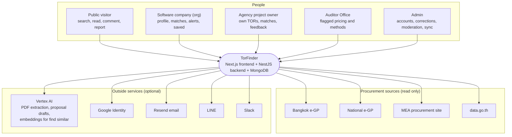
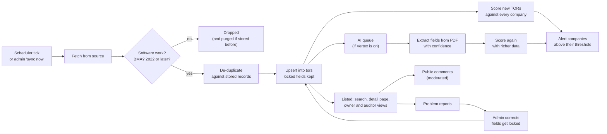

# TorFinder architecture

A map of the code for someone about to change it: what the system is made
of, where each kind of logic lives, how one TOR moves from a government
portal to a company's inbox, and the rules a change must not break.

It sits above the [design diagrams](./design/README.md). Those show
structure (containers, classes, collections, flows); this page tells you
where to go and what to keep true. The containers and module graph are
drawn in [system-architecture.md](./design/system-architecture.md) and are
not repeated here.

## 1. What TorFinder does

Bangkok Metropolitan Administration (BMA) agencies publish software
procurement notices (TORs) on several portals, in different shapes, and a
small software company can't watch them all. TorFinder pulls those notices
from four official sources, keeps only BMA software work from 2022 on, merges
the copies of the same project, reads the attached PDFs with AI when it is
switched on, scores each TOR against every company profile, and tells a
company when one fits. Agencies see who matched their TORs and what the
public said; the Auditor Office sees awards and pricing worth a second look.
Every record links back to the notice it came from.

## 2. Context

TorFinder only reads from the sources. It never writes back to a portal and
never stores a copy of a document: files are streamed from the portal when
someone opens them.

## 3. Codemap

### Repository root

| Path | What lives there | Rule |
| --- | --- | --- |
| `backend/` | NestJS API, importers and schedulers, tests | The only thing that talks to MongoDB and to outside services |
| `frontend/` | Next.js app, translations, frontend tests | Talks to the backend only from the server side |
| `docker/mongo-seed/` | A snapshot of real TORs loaded into an empty database | Refresh it with the command in `restore.sh`; no other dumps in the repo |
| `docker-compose.yml` | The whole system on one machine | Source of the default ports and service names |
| `.github/workflows/auth.yml` | CI | Runs only when `backend/`, `frontend/` or the workflow change |
| `docs/` | This page, requirements, design, process, operations | Updated in the same PR as the code it describes |

### `backend/src/`

One folder per feature, each with its module, controller, service and
`dto/`. Pure rules sit in plain files next to the service so they can be
unit-tested from `dist/` without a database.

| Folder | Owns | Pure-rule files worth knowing |
| --- | --- | --- |
| `config/` | Every environment variable, with its default | `env.ts` is the only place `process.env` is read |
| `database/` | The Mongo client, collection types, indexes, demo seed; also hosts `SessionRevocationService` (global module) | `database.service.ts` is the schema |
| `common/` | Guards, session token, password rules, HTTP client, software filter, base `SyncScheduler` | `software-filter.ts`, `token.ts`, `role.guard.ts` |
| `auth/` | Sign-up, login, Google sign-in, reset and verify links | |
| `accounts/` | Company profile, approval, roles, suspension | |
| `tor/` | TOR CRUD, the shared import path, de-duplication, stages, document relay | `tor-import.service.ts`, `tor-dedup.ts`, `tor-stage.ts`, `tor.constants.ts` |
| `egp/`, `gproc/`, `mea/`, `datagov/` | One importer per source: client, service, scheduler | Each decides what it wants (`isWanted`) and hands records to `TorImportService` |
| `ai/` | Vertex client, PDF extraction queue, proposal drafts | `extraction-confidence.ts`, `tor-extraction.ts` |
| `matching/` | Company ranking, match alerts, budget and bid insight | `matching.scoring.ts`, `match-alerts.ts`, `bid-insight.ts` |
| `similar/` | Find similar TORs from pasted text or one TOR: Vertex embeddings cached in `torEmbeddings`, TF-IDF keyword ranking when Vertex is off or fails | `similar-text.ts` |
| `insights/` | Market insights across all awards (who wins, discounts, competition per agency) | `market-insights.ts` |
| `feedback/` | Public comments and their moderation | |
| `reports/` | "Report a problem" and the admin queue | |
| `owner/` | The agency owner's dashboard | |
| `saved-tors/`, `saved-searches/` | Bookmarks and saved searches | |
| `notifications/` | In-app notifications, email/LINE/Slack delivery, admin sync alerts | `notification-delivery.ts` |
| `audit/` | The audit log of admin actions | |
| `scripts/` | One-off maintenance (`scope-cleanup`) | Count first, change only with `--apply` |

### `frontend/src/`

| Path | What lives there | Rule |
| --- | --- | --- |
| `app/` | Pages (App Router), Server Actions (`actions.ts`), route handlers (`app/api/`) | Data is fetched here, on the server |
| `proxy.ts` | Checks the session cookie and the role before a page renders | Every protected prefix is listed here |
| `lib/` | Backend clients (`*-api.ts`), session helpers, filters, formatting | `session-headers.ts` is how a call carries the session |
| `components/` | UI by area (`public/`, `admin/`, `owner/`, `insights/`, …) and shared `ui/` | Client components never fetch the backend themselves |
| `types/` | Shapes of what the backend returns | Kept in step with `docs/design/api.md` |
| `i18n/`, `../messages/` | next-intl set-up and the Thai and English strings | Every visible string has a key in both files |
| `data/` | Static and demo data | `admin.ts` still backs the mock `/admin/companies` page |

Leftovers that are not part of the design: `app/api/test-db` and
`lib/mongodb.ts` (a direct database connection from the frontend, see the
known issues in [api.md](./design/api.md#known-issues)).

## 4. The life of one TOR

1. **Fetch.** Each source's scheduler extends `SyncScheduler`
   (`common/sync-scheduler.ts`). e-GP and MEA run every 6 hours, data.go.th
   daily, the national e-GP every 3 hours, extraction hourly; all are set in
   `config/env.ts`. An admin's "sync now" joins a run already in progress
   instead of starting a second one.
2. **Filter.** `isSoftwareProject` (`common/software-filter.ts`) is a keyword
   rule, not AI. MEA, the national e-GP and data.go.th add a Bangkok check
   (`tor/thai-locality.ts`); Bangkok e-GP only carries BMA agencies. All
   apply the `TOR_LISTED_SINCE` cutoff. The same rule runs again after each
   sync (`TorImportService.purge`), so tightening it cleans up old records.
3. **De-duplicate.** Copies of one project from different sources collapse
   by project number and stage, then by a close title match
   (`tor/tor-dedup-index.ts`). When two sources disagree, `sourceRank` in
   `tor/tor.constants.ts` decides: manual > egp > gproc > mea > datagov.
4. **Store.** `TorImportService` upserts by `sourceRef` (`egp:…`, `mea:…`).
   Fields an admin corrected are in `lockedFields` and no import overwrites
   them. The stage is one of five (`TOR_STAGES`: plan, draft for comment,
   reference price, invitation, award).
5. **Read the PDF.** If `VERTEX_PROJECT_ID` is set, `ExtractionService`
   picks unread TORs, sends the document to Gemini with a JSON schema, and
   stores scope, qualifications, deliverables, budget, dates and the model's
   confidence, with model name, version and document URL. Failures back off
   for 24 hours, at most three tries.
6. **Match.** `MatchingService.notifyMatches` runs after an import, after an
   admin adds a TOR, and after an extraction. Scores are computed from the
   company profile with plain rules (`matching.scoring.ts`), not stored on
   the TOR. A company is alerted once per TOR and stage when the score
   reaches its threshold (70 by default), through in-app, email, LINE or
   Slack.
7. **Show.** Public pages list only `LISTED_TOR` records (not soft-deleted,
   not marked not-software). Documents open through `TorDocumentService`,
   which streams the portal's file and only accepts a file already recorded
   on the TOR, by position, never a URL from the caller.
8. **Feedback and fixes.** Anyone can comment while the comment window is
   open; comments appear after an admin approves them. Anyone can report a
   problem; an admin fixes the TOR from the report, which locks the edited
   fields and writes an audit entry.

## 5. Where does my change go?

| I want to… | Start in | Also touch |
| --- | --- | --- |
| Add a procurement source | A new folder like `mea/`: client, service with `isWanted`, scheduler extending `SyncScheduler` | Its prefix in `TorImportSource` and `SOURCE_RANK`, `config/env.ts`, [pipeline.md](./operations/pipeline.md) |
| Change what counts as software | `common/software-filter.ts` | Run `npm run scope-cleanup` to count what the new rule drops |
| Change how matches score | `matching/matching.scoring.ts` | `test/matching-scoring.test.mjs` |
| Add a backend route | The feature's controller, a DTO, exactly one guard | [api.md](./design/api.md) |
| Add a page | `frontend/src/app/<path>/page.tsx` | `proxy.ts` if it is protected, both message files |
| Call the backend from a client component | A route handler under `app/api/` or a Server Action | Forward the session with `authHeaders()` |
| Add a setting | `backend/src/config/env.ts` with a safe default | `.env.example`, the README's environment table |
| Add a collection or field | `database/database.service.ts` (type and index) | [er-diagram.md](./design/er-diagram.md) |
| Record an admin action | `AuditService.record(actor, action, detail)` | |

## 6. Rules that must stay true

| Rule | Why | Where it is enforced |
| --- | --- | --- |
| The browser never calls the backend | Keeps the API and its address private; one place to attach the session | `BACKEND_URL` is server-only; client code goes through `app/api/` or Server Actions |
| `SESSION_SECRET` is identical in both services | The frontend checks the cookie itself on every navigation | Nothing checks it; see [deployment-checklist.md](./operations/deployment-checklist.md) |
| Identity comes from the session, never from the request body or a parameter | A caller can write anything in a body | Guards set `request.session`; services take the user id from there |
| One guard admits one role | An admin is not automatically an owner or an auditor | `RoleGuard` subclasses list their roles |
| A revoked session stops working within 30 seconds | Logout, password reset, suspension and role changes must take effect | `SessionRevocationService` (`sessionMinIssuedAt`, 30 s cache) |
| Only BMA software work from 2022 on is listed | SRS hard constraint (FR-26) | Each source's `isWanted`, re-applied by `purge` after every sync |
| An admin's correction outlives every import | Otherwise the next sync undoes the fix | `lockedFields`; `purge` skips corrected records |
| One project is listed once | The same TOR appears on several portals | Dedup index and `sourceRank` |
| Every TOR links to its source | Users must be able to check the original | `sourceUrl` on every imported record |
| Documents are relayed, never stored or fetched by caller-supplied URL | No copyright or storage burden; no server-side request forgery | `TorDocumentService`, `TorArchiveService` |
| The system works with AI switched off | Vertex costs money and may be unavailable | Empty `VERTEX_PROJECT_ID` disables extraction and drafts, and find similar falls back to keywords; matching and filtering never call the model |
| Every AI value carries its confidence, model and version | Low-confidence values must show as unverified | `extraction.confidence`, `model`, `version`, `documentUrl` |
| Public comments are shown only after moderation | Unreviewed text under a government notice is a liability | Default status filter in `FeedbackService`. Known gap: `?status=` on the per-TOR route is not guarded yet ([api.md](./design/api.md#known-issues)) |
| Every admin action is in the audit log | Accountability (FR-25) | `AuditService.record` in each admin path |
| Visible text exists in Thai and English; API errors are in Thai | The users are Thai; the course demo is bilingual | `messages/th.json` and `en.json`; exceptions thrown with Thai messages |
| One backend instance | Rate limits and schedulers live in process memory | Not enforced; running two would double the imports and split the limits |

## 7. Stack

| Layer | Choice |
| --- | --- |
| Frontend | Next.js 16 (App Router), React 19, Tailwind CSS 4, next-intl 4, Recharts 3 |
| Backend | NestJS 11, `@nestjs/throttler`, `class-validator`, Helmet |
| Database | MongoDB 7 through the official `mongodb` driver (no ORM) |
| Auth | HMAC-signed session token in an httpOnly cookie; Google ID tokens via `google-auth-library` |
| AI | Vertex AI (Gemini for extraction and drafts, text embeddings for find similar), optional |
| Notifications | Resend (email), LINE Messaging API, Slack webhooks, all optional |
| Tests | Node's built-in test runner and `fetch`, against a real backend and MongoDB |
| Runtime | Node.js 22, Docker Compose |

## 8. How it runs

Three containers from `docker-compose.yml`: `frontend` on port 3000,
`backend` on 4000, `db` (MongoDB 7) on 27017, seeded with real TORs the
first time its volume is empty. Only the frontend needs to be public. The
importers and the AI queue run inside the backend process, so there is no
separate worker or queue service. Production hosting is not chosen yet
(#235); [deployment-checklist.md](./operations/deployment-checklist.md)
lists what to get right first, and
[maintenance.md](./operations/maintenance.md) what to watch after.

## 9. Where to look next

- Containers, module graph, frontend areas:
  [system-architecture.md](./design/system-architecture.md)
- Collections and indexes: [er-diagram.md](./design/er-diagram.md)
- Step-by-step flows: [sequence-diagrams.md](./design/sequence-diagrams.md)
- Every route: [api.md](./design/api.md)
- Import and AI pipeline in full: [pipeline.md](./operations/pipeline.md)
- Who can do what: [roles-and-features.md](./project/roles-and-features.md)
- How we work on the code: [developer-guide.md](./process/developer-guide.md)
