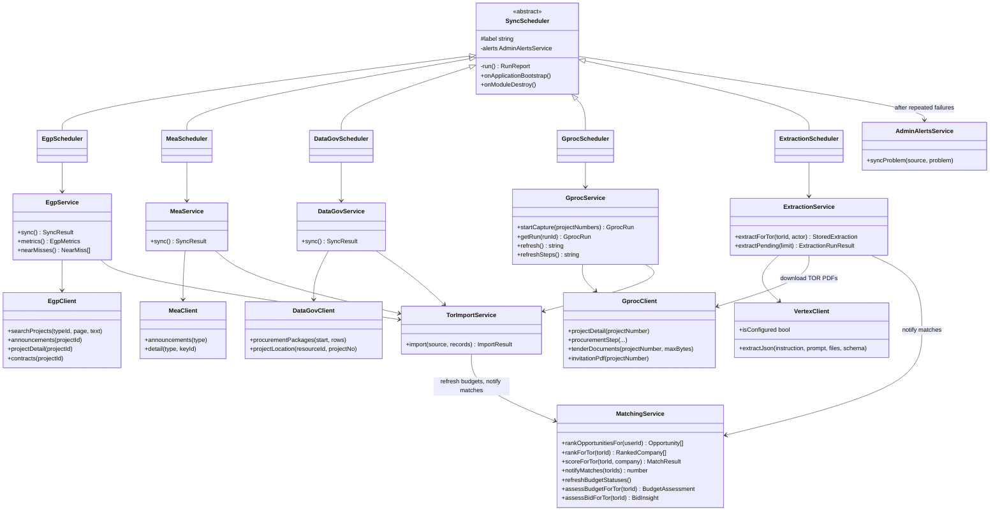
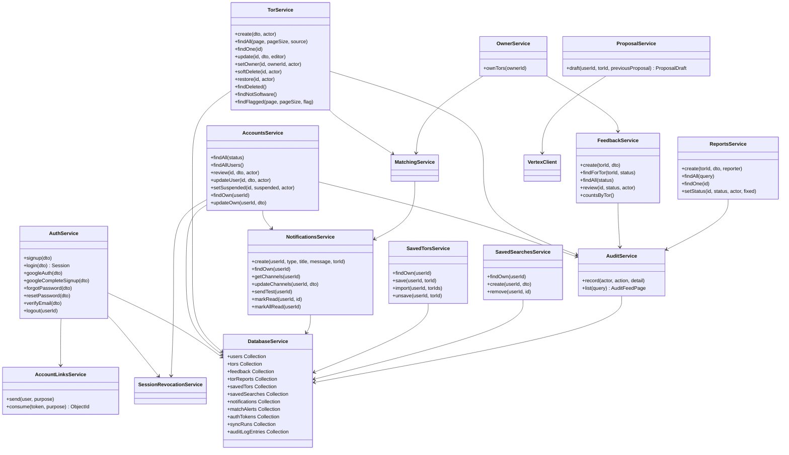

# Class diagram

The main backend classes (`backend/src`) and how they depend on each
other. NestJS creates these classes and injects their constructor
arguments, so an arrow here is a constructor dependency. Only the methods
the rest of the system calls are listed; private helpers are left out.

## Import pipeline: schedulers, sources and AI

## Domain services

Every service also depends on `DatabaseService`; only some of those arrows
are drawn.

## Pure functions behind matching

Scoring is plain functions, not a class, so it can be tested without a
database:

| Function | File | What it does |
| --- | --- | --- |
| `scoreMatch(tor, company)` | `matching/matching.scoring.ts` | 0-100 score from work type, eligibility (capital, past contract, certifications) and project size, with reasons and gaps |
| `rankCompanies(tor, companies)` | `matching/matching.scoring.ts` | Ranks every approved company for one TOR |
| `assessBudget(target, peers)` | `matching/budget-analysis.ts` | Compares a budget with the median of similar TORs |
| `assessBid(target, peers)` | `matching/bid-insight.ts` | Typical discount and competition from past awards |
| `isSoftwareProject(name, category)` | `common/software-filter.ts` | Keyword filter that decides what gets imported (FR-07) |
| `deliver(account, notification)` | `notifications/notification-delivery.ts` | Sends to email, LINE and Slack, whichever the account turned on |
