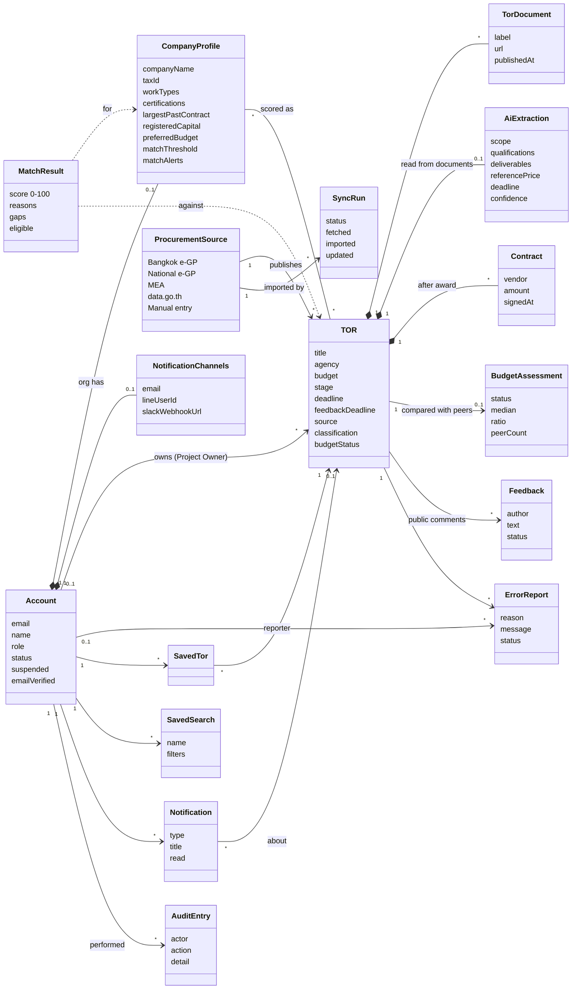
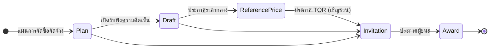
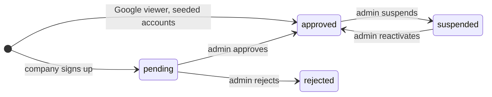

# Domain model

The business concepts TorFinder works with and how they relate, without
database or code detail. For how these are stored, see
[er-diagram.md](./er-diagram.md). For the classes that act on them, see
[class-diagram.md](./class-diagram.md).

## Concepts

| Concept | Meaning |
| --- | --- |
| Account | Anyone who signs in. `role` is one of `admin`, `org`, `owner`, `auditor`, `viewer`. `status` is `pending`, `approved` or `rejected`; only companies start as `pending`. |
| CompanyProfile | What a software company says about itself. It is the input to matching. Only `org` accounts have one. |
| TOR | One procurement announcement at one stage. The same project shows up again at each stage (plan, draft for hearing, reference price, invitation, award). |
| ProcurementSource | Where a TOR came from. When two sources publish the same project, the trust order is manual > Bangkok e-GP > MEA > data.go.th (see [pipeline.md](../pipeline.md)). |
| TorDocument | A file the announcement links to (PDF, or a ZIP bundle). |
| AiExtraction | Fields Gemini read out of the TOR's PDF. `confidence` is shown to users; it does not stop a TOR from being listed. |
| MatchResult | How well one company fits one TOR. Worked out on request with fixed rules (`matching.scoring.ts`), not stored and not done by AI. |
| BudgetAssessment | Whether a TOR's budget is unusually high or low compared with similar ones. The verdict is stored on the TOR as `budgetStatus`, and the Auditor's flagged list reads it. |
| Feedback | A public comment during the hearing period. It waits for admin moderation before it is shown. |
| ErrorReport | Someone saying a TOR is wrong (wrong info, not software, broken link, duplicate, other). An admin resolves it, often by editing the TOR. |
| Notification | An in-app message (`match`, `approval`, `feedback`, `system`). It can also go out by email, LINE or Slack, depending on the account's channels. |
| AuditEntry | A record of an admin action or an automatic job, for the audit log. |
| SyncRun | One run of the Bangkok e-GP import, kept for the pipeline health card. |

## TOR stages

Not every project goes through every stage; the portals often skip the
plan or the reference price. Each stage is stored as its own TOR record and
the detail page joins them into one timeline (`buildTimeline`).

## Account status

`suspended` is a separate flag, not a status value. Suspending keeps the
approval and only blocks sign-in.
