# ER diagram

How data is stored in MongoDB (database `torr`). The types come from
`backend/src/database/database.service.ts`, and the indexes are created in
`DatabaseService.onModuleInit` there.

MongoDB has no foreign keys. A "relationship" below is an `ObjectId` field
pointing at another collection's `_id`, and the code keeps it consistent.
Sub-documents that live inside a record (for example a company profile
inside a user) are drawn as their own boxes, marked "embedded".

```mermaid
erDiagram
    users {
        ObjectId _id PK
        string email UK "lower-case"
        string name
        string role "admin | org | owner | auditor | viewer"
        string status "pending | approved | rejected"
        string passwordHash "absent for Google-only accounts"
        string passwordSalt
        string googleId UK "sparse"
        bool emailVerified
        bool suspended
        date sessionMinIssuedAt "tokens issued before this are refused"
        date lastLoginAt
        date reviewedAt
        date createdAt
    }
    company_profile {
        string companyName
        string taxId "13 digits, set once"
        string contactName
        string phone
        string address
        string specialty
        string size
        string_array techStack
        string_array workTypes
        string_array certifications
        int largestPastContract
        int registeredCapital
        int preferredBudgetMin
        int preferredBudgetMax
        bool matchAlerts
        int matchThreshold "40-95"
    }
    notification_channels {
        bool email
        string lineUserId
        string slackWebhookUrl
    }
    tors {
        ObjectId _id PK
        string title
        string agency
        string budget "display text"
        int budgetAmount
        int referencePrice
        int awardedAmount
        string deadline
        int daysLeft
        string feedbackDeadline
        string stage "one of 5 Thai stage names"
        string summary
        string_array tags
        string budgetStatus "สูงกว่าปกติ | ต่ำกว่าปกติ | ปกติ"
        string classification "software | not-software"
        string sourceRef UK "source:id:type, absent if manual"
        string sourceUrl
        string projectNumber
        string procurementMethod
        string procurementType
        string goodsCategory
        string contractStatus
        string_array lockedFields "fields an admin corrected"
        ObjectId ownerId FK "users._id"
        date createdAt
        date importedAt
        date enrichedAt
        date deletedAt "soft delete"
    }
    tor_document {
        string label
        string url
        date publishedAt
    }
    tor_extraction {
        string scope
        string_array objectives
        string_array qualifications
        string_array deliverables
        int budgetAmount
        int referencePrice
        string deadline
        string feedbackDeadline
        string evaluationCriteria
        float confidence "0-1"
        string model
        string documentUrl
        date extractedAt
        int version
    }
    tor_contract {
        string vendor
        string number
        float amount
        date signedAt
        date startsAt
        date endsAt
    }
    feedback {
        ObjectId _id PK
        ObjectId torId FK
        string author "ประชาชนทั่วไป if blank"
        string text
        string status "รอตรวจสอบ | อนุมัติ | ปฏิเสธ"
        date createdAt
        date reviewedAt
    }
    torReports {
        ObjectId _id PK
        ObjectId torId FK
        string reason "wrong-info | not-software | broken-link | duplicate | other"
        string message
        ObjectId reporter_userId FK "optional"
        string contact
        string status "open | resolved"
        string resolvedBy
        date createdAt
        date resolvedAt
    }
    savedTors {
        ObjectId _id PK
        ObjectId userId FK
        ObjectId torId FK
        date createdAt
    }
    torEmbeddings {
        ObjectId _id PK
        ObjectId torId FK
        string model
        string textHash
        array vector
        date updatedAt
    }
    savedSearches {
        ObjectId _id PK
        ObjectId userId FK
        string name "unique per user"
        object filters
        date createdAt
    }
    notifications {
        ObjectId _id PK
        ObjectId userId FK
        string type "match | approval | feedback | system"
        string title
        string message
        ObjectId torId FK "optional"
        int score
        bool read
        date createdAt
    }
    matchAlerts {
        ObjectId _id PK
        ObjectId userId FK
        string projectKey "egp:projectNumber or tor:id"
        string phase "early | invitation"
        date createdAt
    }
    authTokens {
        ObjectId _id PK
        ObjectId userId FK
        string purpose "password-reset | email-verify"
        string tokenHash UK
        date expiresAt "TTL index"
        date createdAt
    }
    syncRuns {
        ObjectId _id PK
        date startedAt
        date finishedAt
        string status "success | partial | failed"
        int fetched
        int imported
        int updated
        string_array failedFeeds
        string error
    }
    auditLogEntries {
        ObjectId _id PK
        string actor "email of who did it"
        string action
        string detail
        date createdAt
    }

    users ||--o| company_profile : "embedded (org only)"
    users ||--o| notification_channels : embedded
    users |o--o{ tors : "owns (ownerId)"
    tors ||--o{ tor_document : "embedded documents[]"
    tors ||--o| tor_extraction : "embedded extraction"
    tors ||--o{ tor_contract : "embedded contracts[]"
    tors ||--o{ feedback : receives
    tors ||--o{ torReports : "reported in"
    users |o--o{ torReports : files
    users ||--o{ savedTors : bookmarks
    tors ||--o{ savedTors : "bookmarked as"
    tors ||--o{ torEmbeddings : "embedded as"
    users ||--o{ savedSearches : keeps
    users ||--o{ notifications : receives
    tors |o--o{ notifications : about
    users ||--o{ matchAlerts : "already alerted"
    users ||--o{ authTokens : "reset / verify links"
```

`syncRuns` and `auditLogEntries` stand alone: the audit log names the actor
by email, not by `_id`, so entries survive an account being renamed. The
admin audit page merges both collections into one feed.

## Indexes

| Collection | Index | Why |
| --- | --- | --- |
| `users` | `{ email: 1 }` unique | One account per email |
| `users` | `{ status: 1, createdAt: -1 }` | Approval queue |
| `users` | `{ googleId: 1 }` unique, sparse | Google sign-in lookup |
| `tors` | `{ createdAt: -1 }` | Default listing order |
| `tors` | `{ ownerId: 1, createdAt: -1 }` | Owner dashboard |
| `tors` | `{ sourceRef: 1 }` unique, sparse | Re-importing updates instead of duplicating |
| `tors` | `{ stage: 1, projectNumber: 1 }` | Finding other stages of the same project |
| `feedback` | `{ torId: 1, createdAt: -1 }`, `{ status: 1, createdAt: -1 }` | Comments per TOR; moderation queue |
| `torReports` | `{ status: 1, createdAt: -1 }`, `{ torId: 1, createdAt: -1 }` | Admin list; reports per TOR |
| `savedTors` | `{ userId: 1, torId: 1 }` unique, `{ userId: 1, createdAt: -1 }` | No double bookmark; own list |
| `torEmbeddings` | `{ torId: 1, model: 1 }` unique | One vector per TOR per embedding model, for "find similar" |
| `savedSearches` | `{ userId: 1, name: 1 }` unique, `{ userId: 1, createdAt: -1 }` | Names are unique per user |
| `notifications` | `{ userId: 1, createdAt: -1 }` | Own inbox |
| `syncRuns` | `{ startedAt: -1 }` | Latest runs for the pipeline card |
| `auditLogEntries` | `{ createdAt: -1 }` | Newest first |
| `authTokens` | `{ tokenHash: 1 }` unique, `{ userId: 1, purpose: 1 }`, `{ expiresAt: 1 }` TTL | Links expire on their own |
| `matchAlerts` | `{ userId: 1, projectKey: 1, phase: 1 }` unique | Never alert twice for the same phase |

## Rules worth knowing

- **Soft delete.** Hiding a TOR sets `deletedAt`; nothing is removed.
  Listings filter on `deletedAt` not existing and on `classification` not
  being `not-software` (`LISTED_TOR` in `tor.constants.ts`).
- **Admin corrections win.** When an admin edits a field, its name goes
  into `lockedFields`, and later imports leave that field alone.
- **Only TORs since 2022.** Imports drop anything created before
  `TOR_LISTED_SINCE` (default `2022-01-01`).
- **Only hashes are stored.** Passwords use `passwordHash` + `passwordSalt`;
  reset and verify links are stored as `tokenHash` only.
