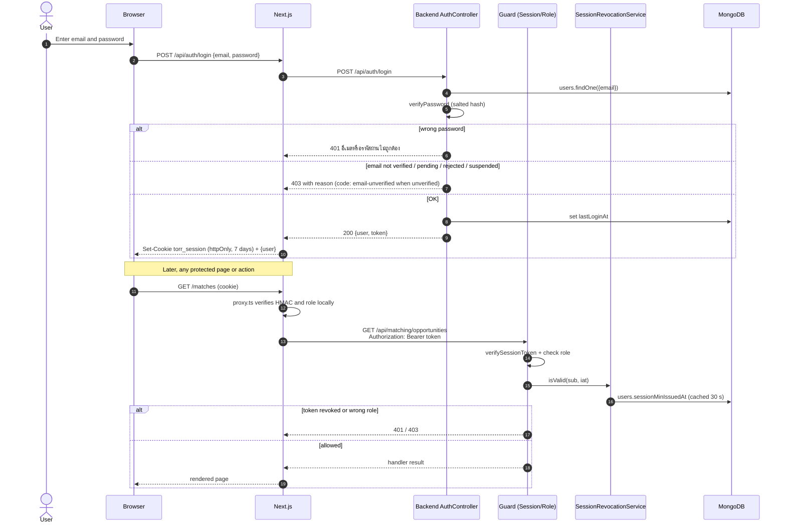
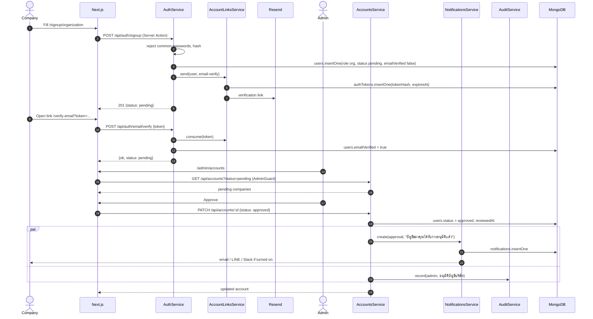
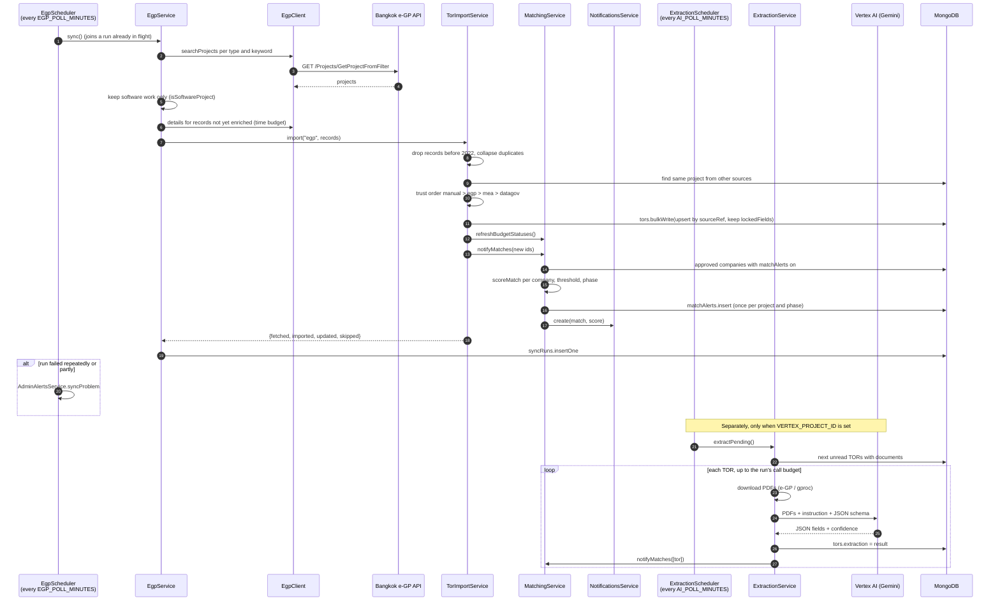
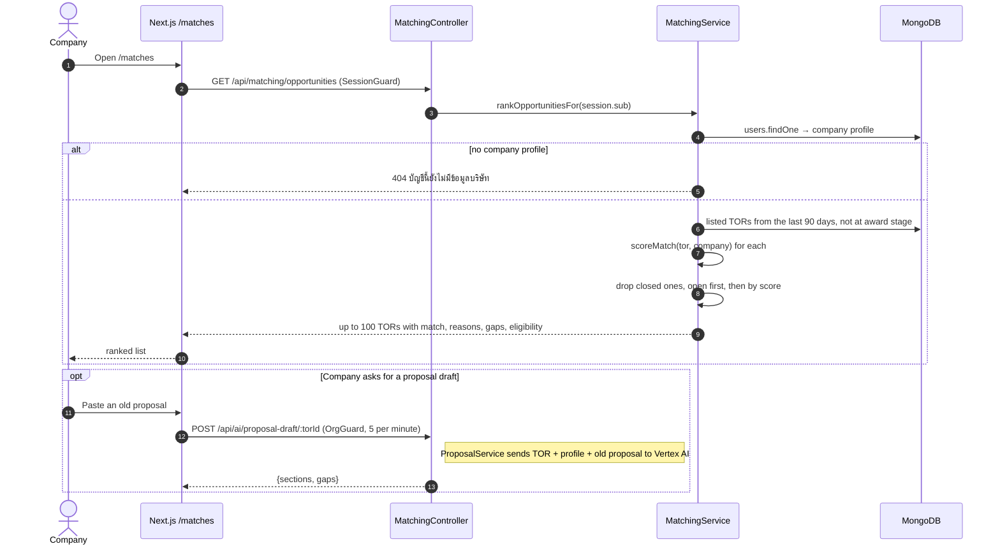
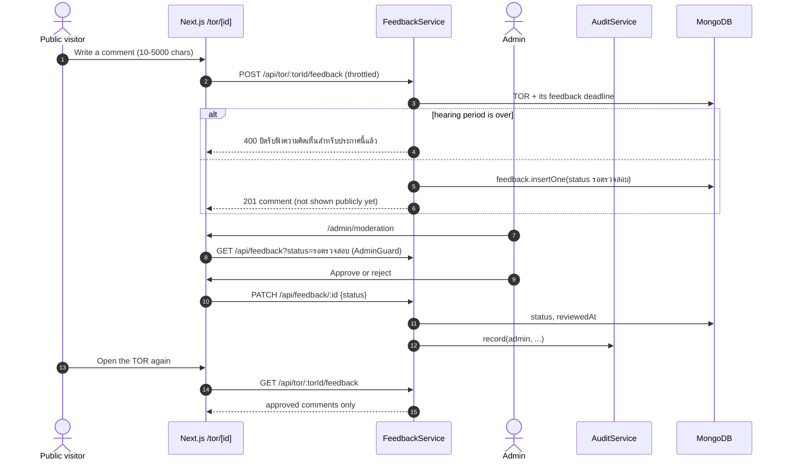
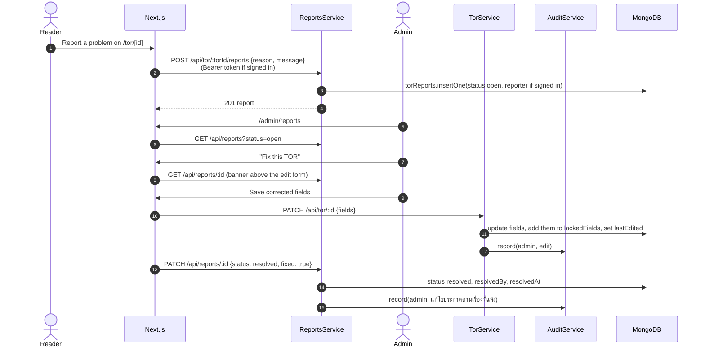

# Sequence diagrams

The main flows through the system, drawn from the code. "Next.js" means the
frontend server (pages, Server Actions and `/api/*` route handlers); the
browser never talks to the backend directly (see
[system-architecture.md](./system-architecture.md)).

1. [Sign in and call a protected route](#1-sign-in-and-call-a-protected-route)
2. [Company sign-up and admin approval](#2-company-sign-up-and-admin-approval)
3. [Scheduled import, AI extraction and match alerts](#3-scheduled-import-ai-extraction-and-match-alerts)
4. [A company opens its matched TORs](#4-a-company-opens-its-matched-tors)
5. [Public comment and moderation](#5-public-comment-and-moderation)
6. [Error report and "Fix this TOR"](#6-error-report-and-fix-this-tor)

## 1. Sign in and call a protected route

Google sign-in follows the same shape through `POST /api/auth/google`. A
new Google user who chose "company" gets `{status: "needs-company-info"}`
back and finishes with `POST /api/auth/google/complete`.

## 2. Company sign-up and admin approval

A pending account cannot sign in (step 1 returns 403) until this flow ends.

## 3. Scheduled import, AI extraction and match alerts

MEA, data.go.th and the national e-GP (gproc) follow the same path through
`TorImportService.import`. The details for each source are in
[pipeline.md](../pipeline.md).

## 4. A company opens its matched TORs

## 5. Public comment and moderation

## 6. Error report and "Fix this TOR"

Because the fields are locked, the next import does not overwrite the
correction.
