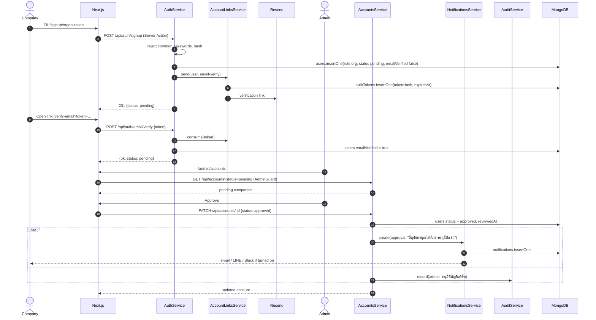
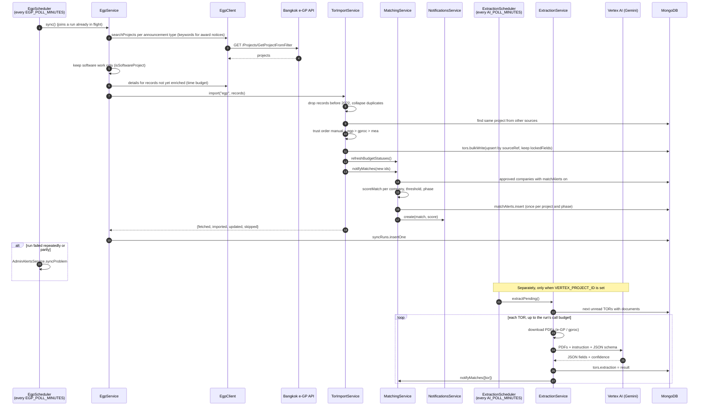
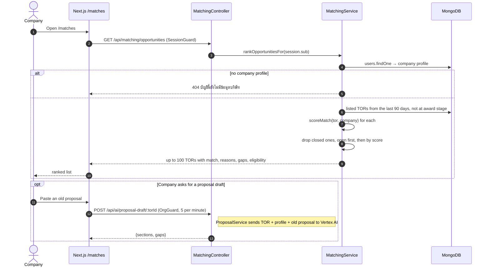
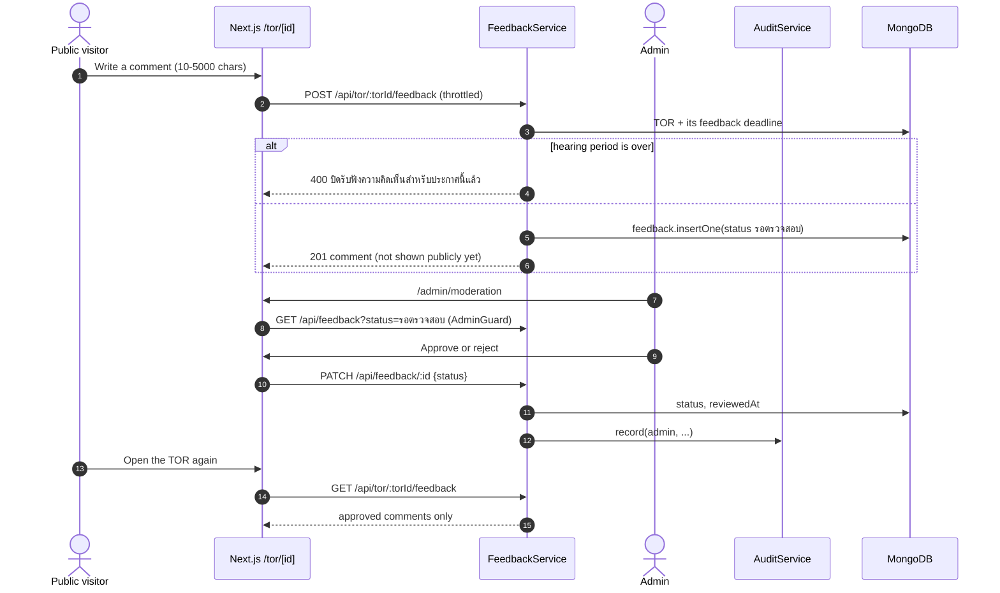
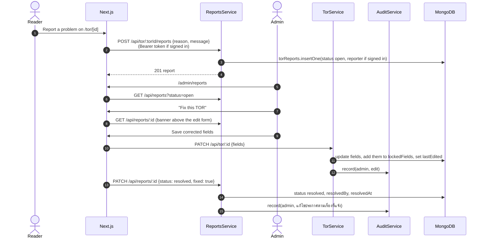

# Sequence diagrams

> **Last reviewed against the code:** 25 Nov 2026 (`main` at `85d6251`). A PR that changes what this page describes updates it in the same PR ([Definition of Done](../process/team-workflow.md#definition-of-done)).

The main flows through the system, drawn from the code. "Next.js" means the
frontend server (pages, Server Actions and `/api/*` route handlers); the
browser never talks to the backend directly (see
[system-architecture.md](./system-architecture.md)).

1. [Sign in and call a protected route](#1-sign-in-and-call-a-protected-route)
2. [Company sign-up and admin approval](#2-company-sign-up-and-admin-approval)
3. [Scheduled import, AI extraction and match alerts](#3-scheduled-import-ai-extraction-and-match-alerts)
4. [A company opens its matched TORs](#4-a-company-opens-its-matched-tors)
5. [Public comment and moderation](#5-public-comment-and-moderation)
6. [Error report and "Fix this TOR"](#6-error-report-and-fix-this-tor)
7. [Sensitive admin action with a passkey check (step-up)](#7-sensitive-admin-action-with-a-passkey-check-step-up)

## 1. Sign in and call a protected route

```mermaid
sequenceDiagram
    autonumber
    actor U as User
    participant B as Browser
    participant N as Next.js
    participant A as Backend AuthController
    participant G as Guard (Session/Role)
    participant R as SessionRevocationService
    participant DB as MongoDB

    U->>B: Enter email and password
    B->>N: POST /api/auth/login {email, password}
    N->>A: POST /api/auth/login
    A->>DB: users.findOne({email})
    A->>A: verifyPassword (salted hash)
    alt wrong password
        A-->>N: 401 อีเมลหรือรหัสผ่านไม่ถูกต้อง
    else email not verified / pending / rejected / suspended
        A-->>N: 403 with reason (code: email-unverified when unverified)
    else staff account with a passkey
        A-->>N: 200 {status: passkey-required, options}
        B->>B: navigator.credentials.get (user touches the key)
        B->>N: POST /api/auth/passkey/login {response}
        N->>A: POST /api/auth/passkey/login
        A->>A: verify signature against users.passkeys[].publicKey
        A->>DB: sessions.insertOne({_id: sid, device, amr})
        A-->>N: 200 {user, token}
        N-->>B: Set-Cookie torr_session (httpOnly, 7 days) + {user}
    else OK
        A->>DB: set lastLoginAt; sessions.insertOne({_id: sid, device, amr})
        A-->>N: 200 {user, token}
        N-->>B: Set-Cookie torr_session (httpOnly, 7 days) + {user}
    end

    Note over B,N: Later, any protected page or action
    B->>N: GET /matches (cookie)
    N->>N: proxy.ts verifies HMAC and role locally
    N->>G: GET /api/matching/opportunities<br/>Authorization: Bearer token
    G->>G: verifySessionToken + check role
    G->>R: isValid(sub, iat, sid)
    R->>DB: users.sessionMinIssuedAt (cached 30 s) and sessions[sid].revokedAt
    alt token revoked, session ended, idle too long or wrong role
        G-->>N: 401 / 403
    else allowed
        G-->>N: handler result
        N-->>B: rendered page
    end
```

The token carries `sid`, the id of the `sessions` record, so the user can
list their sessions on `/account` and end one (`POST /auth/sessions/:id/end`),
and an admin can end all of an account's sessions. Google sign-in follows
the same shape through `POST /api/auth/google`. A
new Google user who chose "company" gets `{status: "needs-company-info"}`
back and finishes with `POST /api/auth/google/complete`.

## 2. Company sign-up and admin approval



A pending account cannot sign in (step 1 returns 403) until this flow ends.

## 3. Scheduled import, AI extraction and match alerts



MEA and the national e-GP (gproc) follow the same path through
`TorImportService.import`. The details for each source are in
[pipeline.md](../operations/pipeline.md).

## 4. A company opens its matched TORs



## 5. Public comment and moderation



## 6. Error report and "Fix this TOR"



Because the fields are locked, the next import does not overwrite the
correction.

## 7. Sensitive admin action with a passkey check (step-up)

Suspending an account, changing a role, reviewing a company, deleting an
announcement or ending someone's sessions needs a passkey check from the
last `STEP_UP_MINUTES` (default 10), not just a session. Granting or
removing the admin role also needs a second admin.

```mermaid
sequenceDiagram
    autonumber
    actor Ad as Admin
    participant B as Browser
    participant N as Next.js (Server Action)
    participant G as AdminGuard + StepUpGuard
    participant P as PasskeysService
    participant S as AccountsService
    participant DB as MongoDB

    Ad->>B: Click "Suspend" on /admin/users
    B->>N: suspend(id)
    N->>G: PATCH /api/accounts/:id/suspend
    alt last passkey check older than STEP_UP_MINUTES
        G-->>N: 403 step-up required
        N-->>B: ask for the passkey
        B->>N: POST /api/auth/step-up/options
        N->>P: challenge
        P-->>B: options
        B->>B: navigator.credentials.get
        B->>N: POST /api/auth/step-up {response}
        N->>P: verify
        P-->>N: session re-signed with pkt = now
        N->>G: retry PATCH /api/accounts/:id/suspend
    end
    G->>S: setSuspended(id, true)
    S->>DB: users.suspended = true; revoke its sessions
    S->>DB: auditLogEntries.insertOne
    S-->>B: updated account
```

For a role change to or from `admin`, `AccountsService` files an
`adminApprovals` request instead of applying it, and every other admin is
notified. Another admin approves it with
`POST /accounts/admin-approvals/:id/approve` (also behind step-up); the one
who asked cannot.
