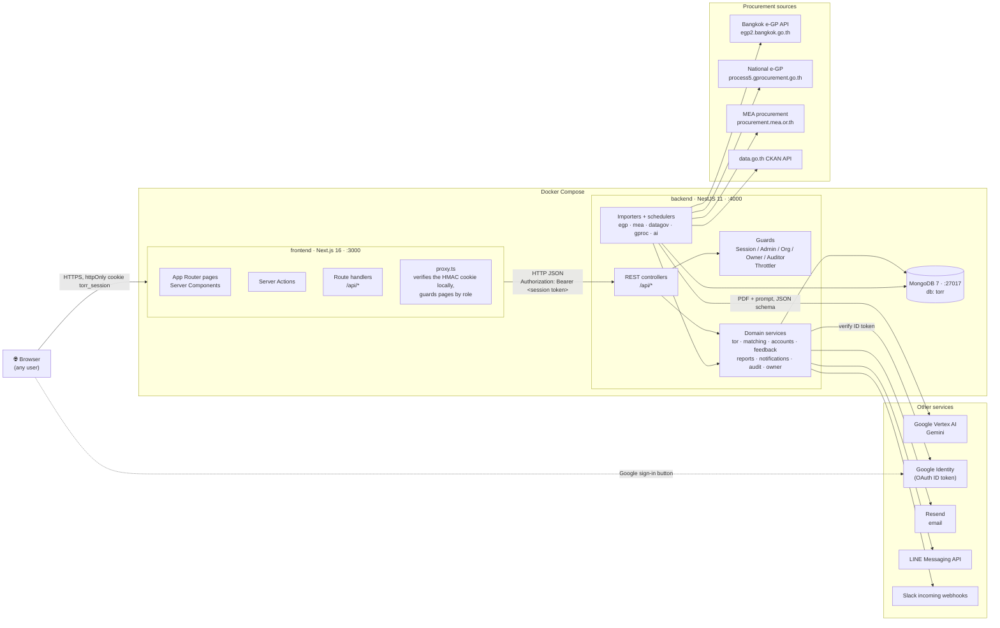
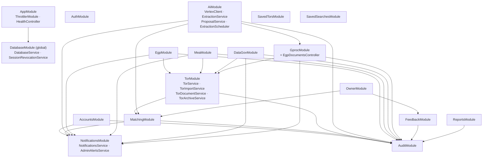

# System architecture

How the pieces of TorFinder run and talk to each other. Pipeline detail
(schedules, dedup order, the AI queue) is in [pipeline.md](../pipeline.md);
this page is the big picture.

## Containers and external systems

## The important decisions

**The browser never calls the backend.** `BACKEND_URL` is server-only.
Pages, Server Actions and the `/api/*` route handlers in `frontend/src/app/api`
call the backend from the Next.js server and forward the session as
`Authorization: Bearer <token>` (`frontend/src/lib/session-headers.ts`). The
backend's CORS allow-list is only a second line of defence.

**One shared secret, two places that check it.** The session token is an
HMAC-signed payload (`sub`, `email`, `name`, `role`, `iat`, `exp`, 7 days),
made by the backend at sign-in (`backend/src/common/token.ts`). The frontend
stores it in the `torr_session` httpOnly cookie and verifies it locally on
each navigation (`frontend/src/proxy.ts`), so `SESSION_SECRET` must be the same in both services. The
backend also checks the account's `sessionMinIssuedAt` on every guarded
call (cached for 30 seconds), so logout, a password reset, a role change or
a suspension makes older tokens stop working
(`SessionRevocationService`).

**Imports run inside the backend process.** Each source has a scheduler
(`EgpScheduler`, `MeaScheduler`, `DataGovScheduler`, `GprocScheduler`,
`ExtractionScheduler`) built on `SyncScheduler`. A run started from the admin
button joins the scheduled run if one is already going. Rate limiting is
in-memory, so the design assumes one backend instance (see
[deployment-checklist.md](../deployment-checklist.md)).

**AI is optional.** Without `VERTEX_PROJECT_ID` the extraction job and the
proposal-draft route are switched off and everything else still works.
Matching, budget checks and the software filter are rule-based and never
call the model.

## Backend modules

Every module also uses `DatabaseModule`; those arrows are left out.
`AppModule` imports all of the modules above.

## Frontend structure

| Area | Path | Notes |
| --- | --- | --- |
| Public | `/`, `/dashboard`, `/search`, `/public`, `/tor/[id]` | Server Components fetch from the backend; `/dashboard` is the public overview |
| Sign-in and sign-up | `/login/*`, `/signup/*`, `/forgot-password`, `/reset-password`, `/verify-email` | Route handlers set or clear the cookie |
| Signed-in | `/matches`, `/profile`, `/saved`, `/notifications` | A Viewer only gets `/saved` |
| Owner | `/owner` | |
| Auditor | `/auditor` | |
| Admin | `/admin/{tor,accounts,users,moderation,reports,audit,notifications,companies}` | `/admin/companies` still uses mock data |
| Route handlers | `frontend/src/app/api/*` | Thin proxies for calls made from client components (see [api.md](../api.md#frontend-route-handlers)) |
| Translations | `frontend/messages/{th,en}.json` | next-intl |

## Deployment

`docker-compose.yml` runs three containers: `frontend` (port 3000),
`backend` (port 4000) and `db` (`mongo:7`, port 27017, seeded from
`docker/mongo-seed/` the first time the volume is empty). There is no
production deployment in the repo yet; see
[deployment-checklist.md](../deployment-checklist.md).
