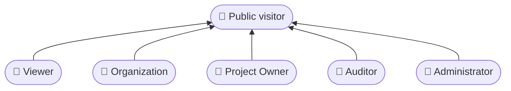
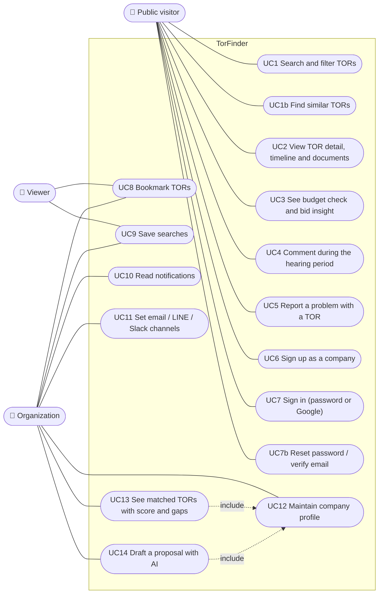
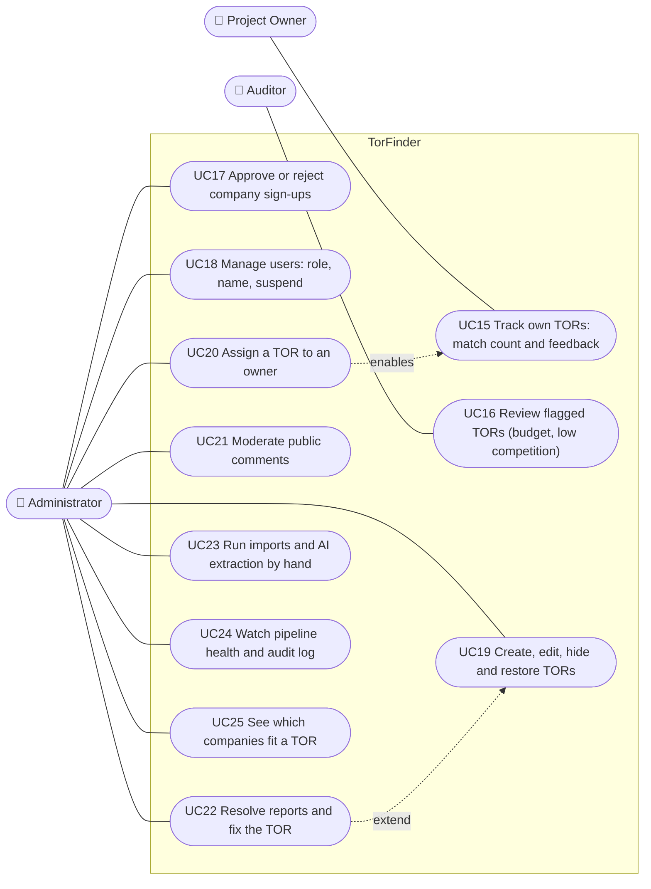
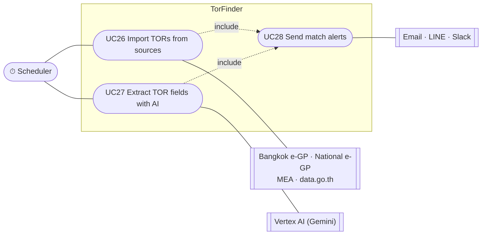

# Use case model

Who uses TorFinder and what each of them can do. Every use case below maps
to a real route; the guard named in brackets is what the backend checks
(see [api.md](./api.md) for the full list).

## Actors

| Actor | Role in code | How they get in |
| --- | --- | --- |
| Public visitor | none | No account |
| Viewer | `viewer` | Google sign-in from `/login/public` |
| Organization (software company) | `org` | Signs up at `/signup/organization`, then waits for an admin to approve |
| Project Owner (agency) | `owner` | An admin moves an existing non-company account to this role |
| Auditor (สตง.) | `auditor` | Same as Project Owner |
| Administrator | `admin` | Same as Project Owner; the first admin is seeded |
| Scheduler | — | Timers inside the backend (`SyncScheduler` subclasses) |

External systems: Bangkok e-GP, national e-GP (process5), MEA procurement
site, data.go.th, Google Vertex AI (Gemini), Google Identity, Resend
(email), LINE Messaging API, Slack webhooks.

## Diagram

Mermaid has no native use case diagram, so actors are drawn as rounded
boxes on the left and use cases as stadium shapes inside the system
boundary. The model is split into three diagrams so each stays readable.

### Actor hierarchy

Signed-in actors can also do everything a public visitor can. Viewer,
Organization, Project Owner, Auditor and Administrator all count as "signed
in" to the backend (`SessionGuard`).

### Public visitors and companies

The backend lets every signed-in account use UC8 to UC11 (`SessionGuard`),
but the frontend only gives a Viewer the `/saved` page
(`frontend/src/proxy.ts`), so Viewer is drawn to bookmarks and saved
searches only.

### Agency, auditor and administrator

### Automatic jobs

## Use case list

| # | Use case | Actor | Route(s) | FR |
| --- | --- | --- | --- | --- |
| UC1 | Search and filter TORs | Anyone | `GET /api/tor` | FR-09, FR-10 |
| UC1b | Find TORs similar to a past project, the company profile or a TOR | Anyone | `POST /api/tor/similar` | FR-09, FR-13 |
| UC2 | View TOR detail, timeline and documents | Anyone | `GET /api/tor/:id`, `/documents/...`, `/egp-documents/...` | FR-11, FR-17 |
| UC3 | See budget check and bid insight | Anyone | `GET /api/matching/tor/:id/budget`, `/bid-insight` | FR-24 |
| UC4 | Comment during the hearing period | Anyone | `POST /api/tor/:torId/feedback` | FR-18, FR-19 |
| UC5 | Report a problem | Anyone | `POST /api/tor/:torId/reports` | FR-21 |
| UC6 | Sign up as a company | Public | `POST /api/auth/signup`, `/auth/google/complete` | FR-01 |
| UC7 | Sign in | Anyone | `POST /api/auth/login`, `/auth/google` | FR-01 |
| UC7b | Reset password / verify email | Anyone | `POST /api/auth/password/*`, `/auth/email/*` | FR-01 |
| UC8 | Bookmark TORs | Signed in | `/api/saved-tors` | FR-15 |
| UC9 | Save searches | Signed in | `/api/saved-searches` | FR-16 |
| UC10 | Read notifications | Signed in | `/api/notifications` | FR-02, FR-14 |
| UC11 | Set notification channels | Signed in | `/api/notifications/channels` | FR-14 |
| UC12 | Maintain company profile | Organization | `GET/PATCH /api/accounts/me` | FR-12 |
| UC13 | See matched TORs | Organization | `GET /api/matching/opportunities` | FR-13 |
| UC14 | Draft a proposal with AI | Organization | `POST /api/ai/proposal-draft/:torId` | — |
| UC15 | Track own TORs | Project Owner | `GET /api/owner/tors` | FR-20 |
| UC16 | Review flagged TORs | Auditor | `GET /api/tor/flagged` | FR-24 |
| UC17 | Approve company sign-ups | Admin | `GET /api/accounts`, `PATCH /api/accounts/:id` | FR-03 |
| UC18 | Manage users | Admin | `/api/accounts/directory`, `/:id/details`, `/:id/suspend`, `/:id/reactivate` | FR-03 |
| UC19 | Create, edit, hide, restore TORs | Admin | `POST/PATCH/DELETE /api/tor`, `/:id/restore` | FR-22 |
| UC20 | Assign a TOR to an owner | Admin | `PUT /api/tor/:id/owner` | FR-20 |
| UC21 | Moderate comments | Admin | `GET /api/feedback`, `PATCH /api/feedback/:id` | FR-23 |
| UC22 | Resolve reports and fix the TOR | Admin | `/api/reports` | FR-21, FR-22 |
| UC23 | Run imports and AI by hand | Admin | `POST /api/{egp,mea,datagov}/sync`, `/gproc/capture`, `/ai/extract` | FR-04, FR-08 |
| UC24 | Watch pipeline health and audit log | Admin | `GET /api/egp/metrics`, `/egp/near-misses`, `/audit` | FR-06, FR-25 |
| UC25 | See which companies fit a TOR | Admin | `GET /api/matching/tor/:id/companies` | FR-13 |
| UC26 | Import TORs from sources | Scheduler | `EgpScheduler`, `MeaScheduler`, `DataGovScheduler`, `GprocScheduler` | FR-04, FR-05, FR-07, FR-26 |
| UC27 | Extract TOR fields with AI | Scheduler | `ExtractionScheduler` | FR-08 |
| UC28 | Send match alerts | Scheduler | `MatchingService.notifyMatches` (after every import and extraction) | FR-14 |

FR numbers refer to [requirements.md](../requirements/summary.md). They are the
closest match, not an official mapping from the SRS.

## Things the diagram does not show

- `/admin/companies` in the frontend still runs on mock data, so there is
  no real "manage companies" use case beyond UC17 and UC18.
- An admin is not automatically an owner or an auditor. Each guard admits
  exactly one role (`backend/src/common/role.guard.ts`).
