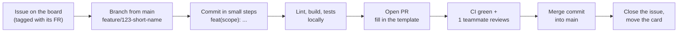

# Developer guide

How we work on the TorFinder code: branches, commits, pull requests and code
style. These rules write down what the team already does in the git history;
when something here and the history disagree, follow the history and fix
this page.

## Getting set up

Follow [Running without Docker](../../README.md#running-without-docker) in the
root README. You need Node.js 22+ and MongoDB 7. Run `npm install` in both
`backend/` and `frontend/`; each has its own `package.json` and lockfile.

## Workflow at a glance



## Branches

- `main` is always deployable. Nobody pushes to it directly; everything
  arrives through a pull request.
- Make one branch per issue, from an up-to-date `main`.
- Name it `<type>/<issue>-<short-name>` in lower case with hyphens. The
  issue number is welcome but optional.

| Prefix | Use for | Example from the repo |
| --- | --- | --- |
| `feature/` | New behaviour | `feature/37-google-oauth-signin`, `feature/admin-reports-list` |
| `fix/` | A bug fix | `fix/proposal-draft-messages`, `fix/local-fonts` |
| `test/` or `tests` | Tests only | `test/iteration-3`, `tests` |
| `chore/` | Tooling, Docker, docs, dependencies | `chore/docker-seed-tors`, `chore/docs-design-and-api` |

Note that a branch called `docs` already exists, so `docs/<name>` cannot be
created (Git can't have both `docs` and `docs/x`). Use `chore/docs-<name>`
for documentation branches.

Delete the branch after it is merged.

## Commits

We use [Conventional Commits](https://www.conventionalcommits.org/) with a
scope:

```
<type>(<scope>): <what changed, in plain words> (#<issue>)
```

| Type | When |
| --- | --- |
| `feat` | Something a user can now do |
| `fix` | Something that was broken now works |
| `test` | Tests only |
| `refactor` | Code changes shape, behaviour doesn't |
| `docs` | Documentation only |
| `chore` | Tooling, dependencies, Docker, CI |
| `style` | Formatting only |

The scope is the area you touched, usually the backend module or frontend
area: `auth`, `tor`, `matching`, `reports`, `feedback`, `owner`, `audit`,
`search`, `admin`, `i18n`, `deps`, `test`.

Good examples from the history:

```
feat(reports): "Fix this TOR" from an error report, with its own audit entry (#227)
feat(search): save a search by name, and apply or delete it from /saved (#208)
fix(i18n): ship the proposal-draft form's strings to the browser
test(feedback): cover the open-for-comments window logic
```

- Write the subject as what the change does for the product, not which
  files moved ("let anyone report a problem with a TOR", not "add
  reports.service.ts").
- Keep the subject under about 72 characters, lower case after the colon,
  no full stop.
- Use the body to say why when the subject can't.
- One logical change per commit. Don't mix a refactor into a feature commit.

## Pull requests

1. Push the branch and open a PR into `main`. GitHub fills in
   [the template](../../.github/pull_request_template.md): fill in every
   section, link the issue with `Closes #123`, and tick the checklist
   honestly.
2. Add screenshots for any UI change, in both Thai and English if the text
   changed.
3. Keep PRs small enough to review in one sitting. Split a big feature into
   backend and frontend PRs if needed.
4. CI must be green (see [testing.md](./testing.md#what-ci-runs)). CI only
   runs for changes under `backend/`, `frontend/` or the workflow file.
5. Ask a teammate to review. Aim for at least one approval from someone
   other than the author before merging.
6. Merge with a **merge commit** (the "Merge pull request" button), which is
   what the history uses. Don't squash or rebase-merge.
7. Close the issue and move its card on the GitHub Projects board.

If `main` moved while your PR was open, merge `main` into your branch and
resolve conflicts there.

## Code style

### General

- TypeScript in strict mode on both sides. Don't use `any`; type what comes
  back from the database and from outside APIs.
- Run `npm run lint` before pushing. ESLint is the only formatter-like check
  in CI (`typescript-eslint` recommended rules in the backend,
  `eslint-config-next` in the frontend).
- Keep secrets and URLs out of code. New settings go in
  `backend/src/config/env.ts` with a safe default, plus `.env.example` and the
  README's environment table.
- Comments explain **why**, not what. Look at `role.guard.ts` or
  `tor.constants.ts` for the house style.
- Never commit `.env`, `.env.local`, credentials, or database dumps other
  than the deliberate seed in `docker/mongo-seed/`.

### Naming

| What | Style | Example |
| --- | --- | --- |
| Variables, functions | `camelCase` | `rankOpportunitiesFor`, `currentDaysLeft` |
| Classes, React components, types | `PascalCase` | `MatchingService`, `TorTimeline`, `TorDoc` |
| Constants and constant lists | `UPPER_SNAKE_CASE` | `TOR_STAGES`, `MAX_SAVED_SEARCHES` |
| Files | `kebab-case` | `saved-searches.service.ts`, `tor-timeline.tsx` |
| MongoDB collections | `camelCase` plural | `torReports`, `savedSearches` |
| API paths | `kebab-case` nouns | `/api/saved-tors`, `/api/matching/tor/:id/bid-insight` |

### Backend (NestJS)

- One folder per feature under `backend/src/`, with a `*.module.ts`,
  `*.controller.ts`, `*.service.ts` and a `dto/` folder.
- Validate every body and query with a DTO and `class-validator`. The global
  `ValidationPipe` drops unknown fields.
- Protect every route that isn't public with a guard: `SessionGuard` for
  "any signed-in account", or exactly one of `AdminGuard`, `OrgGuard`,
  `OwnerGuard`, `AuditorGuard`. Take the user's identity from
  `request.session`, never from the body or a parameter.
- Record admin actions with `AuditService.record(actor, action, detail)`.
- Error messages a user can see are in Thai.
- Keep scoring and other business rules in plain functions (like
  `matching.scoring.ts`) so they can be unit-tested without a database.
- When you add or change a route, update [api.md](../design/api.md) in the
  same PR.

### Frontend (Next.js)

- The browser never calls the backend. Fetch in Server Components or Server
  Actions, or add a route handler under `src/app/api/`, and forward the
  session with `authHeaders()` from `src/lib/session-headers.ts`.
- New protected pages need a prefix in `src/proxy.ts`.
- All visible text goes through next-intl. Add the key to both
  `frontend/messages/th.json` and `en.json`.
- Use Tailwind classes and the existing components in
  `src/components/ui/` before writing new ones. Check light and dark themes.

## Documentation

Update the docs in the same PR as the code they describe:

| If you change… | Update |
| --- | --- |
| A route, its guard, body or response | [design/api.md](../design/api.md) |
| A collection or its fields | [design/er-diagram.md](../design/er-diagram.md) |
| A role or what it can do | [project/roles-and-features.md](../project/roles-and-features.md), [design/use-case.md](../design/use-case.md) |
| An importer or schedule | [operations/pipeline.md](../operations/pipeline.md) |
| An environment variable | Root [README](../../README.md#environment-variables) and `.env.example` |
