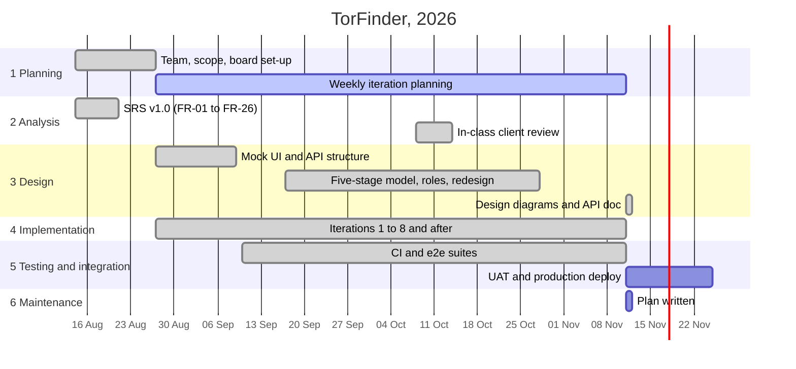

# SDLC: how we actually did each stage

The six stages of the software development life cycle, and what the team
really did in each one on TorFinder, with links to the evidence. We worked
iteratively (see [team-workflow.md](./team-workflow.md)), so the stages
overlapped: every one-week iteration went through a small round of
analysis, design, implementation and testing. The timeline below shows when
each stage carried the most weight.

The planning dates before August 21 and the UAT and deploy dates are
estimates; everything else comes from the SRS, the iteration files and the
git history.

## 1. Planning

**Question:** how and when will we build it?

What we did:

- Formed a three-person team and agreed on the product: one place for
  Bangkok's software procurement TORs, with matching for software companies.
- Set up the GitHub repository and a GitHub Projects board with an
  "Iteration" field, and planned one-week iterations starting August 27.
- Broke the SRS into epics and sub-issues, each tagged with the FR it
  implements and a MoSCoW priority, and planned about 30 points per
  iteration.
- Re-planned every week: unfinished work carried over, and the client's
  October feedback was added as its own epic (#250).
- Planned the production release as its own epic (#235 to #240).

Evidence: [project-plan.md](../project/project-plan.md),
[iterations/](../project/iterations/), issues #235 to #240 and #250.

## 2. Analysis

**Question:** what must the system do?

What we did:

- Wrote the SRS (v1.0, August 21): the problem, scope, five stakeholder
  groups, 26 functional requirements with MoSCoW priority, non-functional
  requirements with numbers, business rules, user stories and a
  traceability table.
- Fixed the hard constraints early: Bangkok (BMA) agencies only, from 2022
  on, software work only, official sources only.
- Went back to analysis after the in-class review in October, which added
  13 client requests (search sort, charts, LINE, proposal library and so
  on).
- Wrote down success measures with targets in [kpi.md](../requirements/kpi.md).

Evidence: [srs.md](../requirements/srs.md),
[summary.md](../requirements/summary.md), [kpi.md](../requirements/kpi.md),
epic #250.

## 3. Design

**Question:** how is the system structured, and how do users use it?

What we did:

- Started with mock pages and a base API structure to agree on screens and
  routes before real data existed (PRs #29 and #30).
- Chose the architecture: Next.js frontend that never exposes the backend,
  NestJS backend with one module per feature, MongoDB, HMAC session tokens
  shared by both, scheduled importers inside the backend, and optional
  Vertex AI.
- Changed the design as we learned: a five-stage TOR model instead of three,
  separate owner and auditor roles with one-role guards, de-duplication
  across sources with a trust order, locked fields for admin corrections, and
  a full UI redesign in late October.
- Documented the result as a use case model, domain model, system
  architecture, ER, class and sequence diagrams, and an API reference.

Evidence: [design/](../design/README.md), [api.md](../design/api.md),
[roles-and-features.md](../project/roles-and-features.md).

## 4. Implementation

**Question:** build it.

What we did:

- Built feature by feature from the board: one branch per issue, Conventional
  Commits, pull requests into `main` (97 merged by November 11).
- Delivered 25 of the 26 functional requirements fully and one partly (no
  tech-stack filter for FR-10), plus extras: AI proposal drafts, bid insight,
  four data sources instead of one, LINE and Slack alerts.
- Every member worked on both backend and frontend.

Evidence: [roles-and-features.md](../project/roles-and-features.md#feature-status-against-the-srs),
[developer-guide.md](./developer-guide.md), the git history.

## 5. Testing and integration

**Question:** does it work, and does it work together?

What we did:

- Wrote about 520 backend tests (38 files) and 77 frontend tests (9 files)
  with Node's built-in runner, mostly end-to-end against a real backend and
  MongoDB.
- Set up GitHub Actions to lint and build both apps, run every backend test
  against MongoDB 7, and build the Docker images on every pull request.
- Integrated through `main` and Docker Compose: `docker compose up` runs the
  whole system with a snapshot of real TORs.
- Ran a security self-audit against OWASP ASVS Level 1.
- Still to do: run the frontend tests in CI, a UAT session with a script
  (#232), test every FR against the SRS checklist (#171), and deploy to
  production (#235).

Evidence: [testing.md](./testing.md), [asvs-l1.md](../security/asvs-l1.md),
`.github/workflows/auth.yml`, issues #170, #171, #232.

## 6. Maintenance

**Question:** how do we keep it working after release?

What we did: the system is not in production yet, so this stage is a plan
rather than a record. It covers monitoring the imports, backups,
dependency and security updates, how to handle bug reports from users (the
in-app "Report a problem" flow already feeds an admin queue), and keeping
the docs in step with the code.

Evidence: [maintenance.md](../operations/maintenance.md),
[deployment-checklist.md](../operations/deployment-checklist.md).
