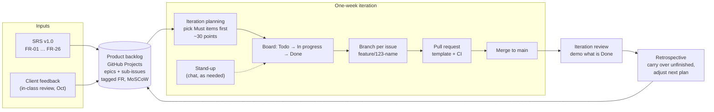

# Team workflow

How the three of us (Bhumipat, Nisara, Sai Khun) ran the project, starting
from Scrum and adjusting it to a three-person course team. The numbers come
from the GitHub repository and the team's GitHub Projects board as of
November 11, 2026.

> **Team to check:** the cadence and artifacts below are read from the board
> and the git history. The meeting details (when stand-ups happened, who
> facilitated) are not visible there; correct them where they differ from
> what we actually did.

## The cycle

## Roles

Scrum names three roles. With three people, everyone developed, and the
other two roles were shared rather than held by one person.

| Scrum role | How it worked here |
| --- | --- |
| Product Owner | The team together, from the SRS and the course's client feedback. The client's in-class review in October became its own epic (#250) with 13 items. |
| Scrum Master | Shared. Whoever planned the iteration on the board kept it moving. |
| Developers | All three, full-stack. Every member committed to both `backend/` and `frontend/`; Nisara also wrote most of the test suites. |
| Stakeholders | The course instructor and TA (as client), BMA agencies, software companies, the public and สตง. as described in the SRS. |

## Cadence

| Event | When | What happens | Evidence |
| --- | --- | --- | --- |
| Iteration | One week, Thursday to Wednesday, from Aug 27 | A fixed slice of the backlog | GitHub Projects "Iteration" field, [iterations/](../project/iterations/) |
| Iteration planning | Start of each iteration | Pull epics and sub-issues into the iteration; estimate about 30 points; Must before Should before Could | Estimates in each iteration file |
| Daily work / stand-up | Ongoing | Move cards Todo → In progress → Done; raise blockers in the team chat | Board status, PR activity |
| Review | End of each iteration | Show what is Done; the October in-class review with the client was the big one | Epic #250 |
| Retrospective | End of each iteration | Unfinished items carry over to the next iteration; scope is adjusted | Iterations 4 to 7 carry work forward |

## Artifacts

| Artifact | Where |
| --- | --- |
| Product backlog | GitHub Projects board "TORFinder": 188 issues so far (165 closed, 23 open), epics with sub-issues, each tagged with its FR and MoSCoW priority |
| Iteration backlog | The board's Iteration view; written up in [project/iterations/](../project/iterations/) |
| Increment | `main`, always runnable with `docker compose up`; 97 pull requests merged into it |
| Definition of Done | Below |

## Definition of Done

An item is Done when:

1. The code is merged into `main` through a pull request that fills in the
   [template](../../.github/pull_request_template.md) and links its issue.
2. CI is green: lint and build for both apps, and the backend tests.
3. New behaviour has tests where it can be tested (see
   [testing.md](./testing.md)).
4. User-facing text exists in both Thai and English.
5. The docs it affects are updated (see the table at the end of
   [developer-guide.md](./developer-guide.md)).
6. The card is moved to Done and the issue is closed.

## What we would change

Things the history shows we could do better, for the next project or the
rest of this one:

- **Reviews.** Only 9 of 97 pull requests have a recorded GitHub approval,
  so most review happened outside GitHub or not at all. Requiring one
  approval in branch protection would make review visible.
- **Smaller iterations at the end.** Iterations 6 and 7 planned 4 and 13
  items and finished 1 each, while most of the work landed in one week at
  the end of October. Splitting epics into smaller sub-issues would keep the
  board honest.
- **Frontend tests in CI.** The frontend has 77 tests that CI never runs.
- **Keep the board in sync with the code.** Some issues (for example #257
  charts and #258 LINE notifications) are still open although the feature
  has shipped.
