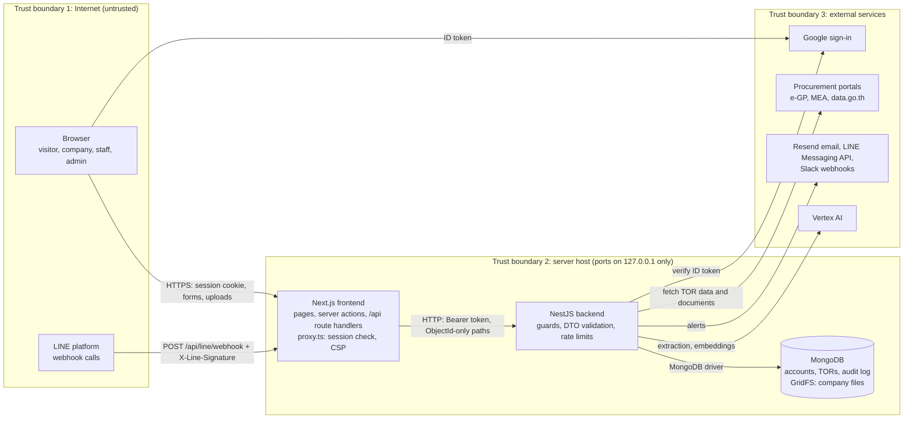

# Threat model

STRIDE threat model of TorFinder for the Software Development Security course (01219325): threats found on the data-flow diagram, scored by likelihood × impact, with the mitigation for each and whether it is in place. First drafted on 16 Nov 2026; this revision (18 Nov 2026) matches `main` after the SAST and DAST scans and the feature PRs #354, #355 and #358.

## Summary

We found **36 threats**. **34 are mitigated, 2 are partly mitigated (both Low), and none is open.** All 3 Critical and all 15 High threats are closed.

- **New since the first draft:** 9 threats, from three features that add new entry points (company file uploads in #354 and #355, the public LINE webhook in #358) and from what the SAST and DAST scans showed.
- **Partly mitigated:**
  - E3: a host allowlist for document fetches. Stretch issue #345.
  - D6: a rate limit on the LINE webhook.

| Priority | Threats | Mitigated | Partial | Open |
| --- | --- | --- | --- | --- |
| Critical | 3 | 3 | 0 | 0 |
| High | 15 | 15 | 0 | 0 |
| Medium | 12 | 12 | 0 | 0 |
| Low | 6 | 4 | 2 | 0 |
| **Total** | **36** | **34** | **2** | **0** |

How the mitigations are checked:

- **ASVS:** each mitigation names the OWASP ASVS 5.0 requirement it meets. The full audits are [asvs-l1.md](./asvs-l1.md) (Level 1, 0 Fail) and [asvs-l2.md](./asvs-l2.md) (Level 2).
- **SAST:** [sast-report.md](./sast-report.md) (CodeQL and Semgrep) found one new threat class, T5, and confirmed T8.
- **DAST:** [dast-report.md](./dast-report.md) (OWASP ZAP, signed-in active scan) found no injection, XSS or path traversal that worked. Its one real finding was a page without a script CSP, which strengthens S5.

## Scope, assets and actors

**In scope:** the Next.js frontend, the NestJS backend, MongoDB (with GridFS for company files), and the Docker Compose deployment in this repository, as of `main` on 18 Nov 2026.

**Out of scope:**
- the hosting provider and its TLS setup
- the third-party services themselves (Google, LINE, Resend, Vertex AI, the procurement portals); only how TorFinder talks to them is covered

| Asset | Why it matters |
| --- | --- |
| User accounts and password hashes | Company, staff and public accounts; taking one over means acting as that organization or as an admin |
| Session tokens and `SESSION_SECRET` | Whoever holds the secret can mint a token for any role |
| Role and approval state | Decides who can edit TORs, approve companies and read moderation queues |
| Company profiles, certificates and proposal library | Business details, certificate scans, CVs and past-project files; private to each company |
| Notification channels | Where a company's alerts go: email, Slack webhook, LINE user id |
| Moderation data | Pending and rejected feedback, problem reports, the audit log |
| TOR records and documents | Public, but their integrity matters: a bidder acts on dates and budgets |
| Secrets and credentials | `SESSION_SECRET`, MongoDB credentials, Resend and LINE keys, the LINE channel secret, Google Cloud credentials |
| Availability | Sign-in, search and the scheduled imports from e-GP, MEA and data.go.th |

| Actor | Trust level |
| --- | --- |
| Anonymous visitor | Untrusted; can search, read TORs, comment and report |
| Public viewer (Google sign-in) | Low; approved automatically, can save TORs and searches |
| Organization (`org`) | Medium; approved by an admin, sees its matches, keeps its certificates and library, drafts proposals |
| Project owner, auditor | Staff; read their own dashboards |
| Admin | High; manages accounts, TORs, moderation and imports |
| External attacker | Untrusted; may script requests, guess passwords or rotate IPs |
| Procurement portals | Semi-trusted data sources; files and fields are checked before use |
| LINE platform | Semi-trusted; its webhook calls are believed only with a valid signature |

## Data-flow diagram

Untrusted input enters only through the frontend: browsers through pages and route handlers, and LINE through its webhook. The frontend forwards the session to the backend as a bearer token. It builds every backend path from ObjectIds and fixed names, and passes the LINE webhook through byte for byte. The backend re-checks every request before it touches MongoDB: guard, role, DTO, ownership, and the LINE signature. Outbound calls to Google, the portals, LINE and the notification services cross the third boundary.

## Threats (STRIDE)

L = likelihood and I = impact, each rated 1–3. Priority comes from L × I (see [Priorities](#priorities)). Status is as of 18 Nov 2026; **new** marks a threat added in this revision.

| ID | Threat | Where | L | I | Priority | Mitigation | ASVS | Status |
| --- | --- | --- | --- | --- | --- | --- | --- | --- |
| S1 | Forge an admin session token with the public dev `SESSION_SECRET` | Compose, token signing | 3 | 3 | Critical | Production refuses a missing, published or short secret (`backend/src/config/env.ts`, `frontend/src/lib/auth.ts`); compose has no fallback | 9.1.3 | Done (#321) |
| S3 | Sign in as a seeded demo admin whose password is in the README | Seed data, compose | 3 | 3 | Critical | Demo accounts opt-in only (`SEED_DEMO_DATA`), off by default, warned about in production | 6.3.2 | Done (#321) |
| E1 | Reach admin, owner or auditor routes as an org or viewer | Backend routes | 3 | 3 | Critical | One role guard per route (`backend/src/common/*.guard.ts`); a guard admits only the roles it names | 8.2.1, 8.3.1 | Done |
| S2 | Guess a password by brute force or credential stuffing | `POST /auth/login` | 3 | 2 | High | 5 per minute per client IP, plus 10 failures per email per 15 min (`backend/src/auth/login-attempts.ts`) | 6.3.1 | Done (#321) |
| S4 | Take over an account by linking a Google identity with an unverified email | Google sign-in | 2 | 3 | High | Token audience checked; link only when Google marks the email verified | 6.8.1, 6.8.2 | Done |
| S5 | Steal a session cookie through XSS or plain HTTP | Browser, frontend | 2 | 3 | High | httpOnly `__Host-` cookie, Secure, HSTS; React escaping, no `dangerouslySetInnerHTML`; strict nonce CSP with `'strict-dynamic'` (`frontend/src/proxy.ts`, #343) and a strict fallback CSP on every other response (`frontend/next.config.ts`, #357, from the DAST scan) | 3.3.1, 3.4.1, 3.4.3, 1.2.1 | Done |
| S7 | **New.** Forge a LINE webhook call to link an attacker's LINE to someone's account, or to unlink theirs | `POST /api/line/webhook` | 2 | 3 | High | `X-Line-Signature` checked over the raw body with HMAC-SHA256 and `timingSafeEqual`; every call refused while no channel secret is set; bad signatures logged as `line.webhook.bad_signature` (`backend/src/notifications/line-link.ts`, `line-webhook.controller.ts`) | 4.1.5 | Done (#358) |
| T1 | NoSQL injection through query or body fields | Backend, MongoDB | 2 | 3 | High | Whitelisting DTOs drop unknown fields; typed filters with `$eq`; `$regex` input escaped (`backend/src/common/regex.ts`) | 1.2.4, 2.2.2 | Done |
| T3 | Raise own role by editing the token or sending `role` in a body | Tokens, account APIs | 2 | 3 | High | HMAC checked before use; DTO whitelist; role change revokes sessions | 9.1.1, 8.2.3 | Done |
| T6 | **New.** Upload a malicious file (HTML or SVG renamed `.pdf`, a script polyglot) that runs in our origin or attacks the company's own staff when opened | Certificate and library uploads | 2 | 3 | High | Type taken from the file's bytes, allowlist PDF/PNG/JPEG (+ `.docx` with real Word parts) (`backend/src/common/stored-files.ts` `sniffFileType`); name reduced to a display name with the real extension; stored in GridFS, never on disk; served as `attachment` with `nosniff` and `no-store` | 5.2.2, 5.3.1, 1.3.4, 3.2.1 | Done (#354, #355) |
| I1 | Read pending and rejected feedback through the public route | `GET /tor/:id/feedback` | 3 | 2 | High | Public route returns approved comments only | 8.2.1 | Done (#321) |
| I4 | Leak a secret that was once committed to a public repository | Git history | 2 | 3 | High | All 372 commits scanned: no real secret ever committed; `.env` files never tracked ([logging-and-errors.md](./logging-and-errors.md#secret-scan-of-the-git-history)) | 13.3.1 | Done (scan clean) |
| I7 | Read another account's saved TORs, searches or notifications (IDOR) | Account data APIs | 2 | 3 | High | Every query filters on the session's user id, never a request field | 8.2.2 | Done |
| I8 | **New.** Read, replace or delete another company's certificates, library records or files (IDOR) | `/certificates`, `/library` | 2 | 3 | High | `OrgGuard` on every route; records live inside the session user's own document and every query matches `_id` = session user plus the record id (`backend/src/certificates/certificates.service.ts`, `backend/src/library/library.service.ts`) | 8.2.2 | Done (#354, #355) |
| D1 | Lock every user out with 5 bad logins, because all logins share the frontend's IP | Throttling | 3 | 2 | High | Client IP forwarded and trusted only from private hops; per-email limit | 6.3.1 | Done (#321) |
| D4 | Crash the backend through a known flaw in a dependency | `body-parser`, `proxy-addr`, others | 2 | 3 | High | `npm audit fix`; CI fails on high/critical (`.github/scripts/npm-audit.mjs`); Dependabot with grouping and a 7-day cooldown. The only way past an advisory is a reasoned entry with an expiry date in `.github/audit-exceptions.json`. One exists: `picomatch` GHSA-fc5q-39xc-vjpf has no patched release, and is reachable only through next-intl's message extractor, which TorFinder doesn't enable. It expires 2026-12-31 | 15.2.1 | Done (#321, #336) |
| E2 | Keep using a stolen session after logout, password change or suspension | Sessions | 2 | 3 | High | Per-user revocation time checked on every guarded request; 30-minute inactivity timeout and 7-day absolute lifetime (#343) | 7.4.1, 7.4.2, 7.3.1 | Done |
| E4 | Reach MongoDB or the backend directly from the network | Docker Compose | 2 | 3 | High | Every port bound to `127.0.0.1`; credentials from `.env` | 13.2.1 | Done (#321) |
| S6 | Guess or steal a password-reset link | Reset and verify emails | 1 | 3 | Medium | 32 random bytes, stored hashed, 1 h expiry, single use; Referrer-Policy | 6.4.1, 14.2.1 | Done |
| T2 | Make a signed-in user's browser change data from another site (CSRF) | Frontend route handlers, server actions | 2 | 2 | Medium | `SameSite=Lax` cookie; server actions check `Origin` (confirmed by hand during the DAST scan); no state change on GET | 3.5.1–3.5.3 | Done |
| T4 | Serve HTML disguised as a portal PDF to run script on our origin | Document relay | 1 | 3 | Medium | PDF/JPEG/PNG allowlist, magic-byte check, `nosniff` | 3.2.1, 5.2.2 | Done |
| T5 | **New.** Walk a frontend→backend request to a different backend route with an id such as `..` (request forgery / path traversal) | Server actions and `/api` route handlers | 2 | 2 | Medium | `idPath()` admits only a 24-hex ObjectId (`frontend/src/lib/backend-path.ts`, #341, from CodeQL `js/request-forgery`). The certificate and library routes from #354/#355 used `encodeURIComponent` alone, which leaves `..` as is: `/api/certificates/../file` reached the backend as `/api/file`. Fixed in this revision: those routes check ids and kinds, and `frontend/src/lib/backend-proxy.ts` refuses any `.` or `..` segment | 1.3.6 | Done (#341, this PR) |
| T7 | **New.** Send a company's alerts to someone else's LINE by pasting their LINE user id | `PUT /notifications/channels` | 2 | 2 | Medium | A LINE id can no longer be set by hand; it comes only from the link flow, from the sender of a signed webhook message | 8.2.2 | Done (#358) |
| R1 | Deny or miss account abuse because sign-ins, failures and lockouts aren't logged | Auth service | 2 | 2 | Medium | JSON security events for sign-in success and failure, lockout, password change, logout, refused access and 429s, with time and client IP ([logging-and-errors.md](./logging-and-errors.md)) | 16.2.1, 16.3.1 | Done (#337) |
| R2 | Deny an admin action (approve, suspend, edit TOR) | Admin APIs | 2 | 2 | Medium | Audit log of admin actions with actor and time, at `/admin/audit` | 16.3.x | Done |
| I2 | List every database collection through a leftover debug route | `/api/test-db` | 2 | 2 | Medium | Route and its direct database connection deleted | 8.2.1, 15.3.1 | Done (#321) |
| I3 | Learn internals (stack traces, connection strings) from error responses | Both apps | 2 | 2 | Medium | Global filter: a generic message and an `errorId` to clients, full details only in server logs (`backend/src/common/all-exceptions.filter.ts`) | 16.5.1 | Done (#337) |
| D2 | Flood the API, or run up AI costs through "find similar" | Backend | 2 | 2 | Medium | 100/min per IP overall; 30/min similar; 5/min AI drafts | 2.4.1 | Done |
| D3 | Exhaust memory with a huge document or a zip bomb from a portal | Document relay | 2 | 2 | Medium | 40 MB caps; inflate limited to the declared size | 5.2.1, 5.2.3 | Done |
| D5 | **New.** Exhaust memory or storage with uploads or the generated starter-pack ZIP | Certificate and library uploads, `/library/starter-pack` | 2 | 2 | Medium | Multer limits: 5 MB, 1 file, 0 extra fields; 100 certificates and 200 library records per company; the pack stops adding files past 60 MB; global rate limit | 5.2.1, 2.4.1 | Done (#354, #355) |
| I5 | Leak a sign-up email address through the URL | Signup | 2 | 1 | Low | Email kept in a 30-minute httpOnly cookie | 14.2.1 | Done |
| I6 | Find out which emails have accounts | Login, forgot-password | 2 | 1 | Low | Same answer for known and unknown emails; lock counts unknown emails too | 6.3.8 | Done |
| S8 | **New.** Guess a live LINE link code and link one's own LINE to another account | LINE webhook | 1 | 2 | Low | 8 characters from a 31-letter alphabet (~39 bits) from `randomInt`; valid 10 minutes, single use, stored as a SHA-256 hash; every guess must be a separate LINE message | 6.4.1 | Done (#358) |
| T8 | **New.** Pollute an object's prototype with a key such as `__proto__` or `constructor` from a request | `tor.service.ts` `changedFields`, library `:kind` | 1 | 2 | Low | DTO whitelist; `changedFields` skips prototype keys (#341); the library's `kind` check uses `Object.hasOwn` instead of `in` (this PR). CodeQL alert #24 still flags `changedFields`; closing it is issue #350 | 15.3.6 | Done (alert open in #350) |
| E3 | Make the backend fetch an internal address through an admin-entered document URL (SSRF) | Document relay | 1 | 2 | Low | Only URLs stored on a TOR are fetched, and only PDF/image paths; admin-only input. A host allowlist is not in place (stretch issue #345) | 1.3.6, 15.3.2 | Partial |
| D6 | **New.** Flood the public LINE webhook, or the security log with `bad_signature` events | `POST /api/line/webhook` | 2 | 1 | Low | Signature check is cheap and fails closed; but the route has `@SkipThrottle()`, so it has no rate limit. A generous limit (e.g. 300/min) is the remaining step | 2.4.1 | Partial |

## Priorities

Score = likelihood × impact, each rated 1 (low) to 3 (high). Mitigations were implemented highest score first.

| Score | Priority | Meaning | Handled |
| --- | --- | --- | --- |
| 9 | Critical | Easy to do, and gives away the whole system | First, before anything else |
| 6 | High | A real attack on one account, one data set or availability | Next, in the same release |
| 3–4 | Medium | Needs effort or gives limited gain | After Critical and High |
| 1–2 | Low | Unlikely, or minor harm | When time allows |

**Order of work:**

1. **Critical (S1, S3, E1):** the known session secret and the seeded admin were fixed first. Role guards on every route were already in place and were re-checked (PR #321).
2. **High:** in this order:
   - the feedback leak (I1)
   - dependency advisories (D4)
   - the shared login bucket and the per-email limit (S2, D1)
   - port exposure (E4)
   - confirming the existing controls for S4, S5, T1, T3, I7 and E2

   The git-history secret scan (I4) was done before the remaining Medium work and found no real secret.
3. **Medium:** in this order:
   - cookie and header hardening, the debug route (I2), document and zip limits (D3), all in PR #321
   - sign-in logging (R1) and the error-message review (I3), in PR #337
   - request forgery (T5), from the SAST scan, in PR #341
4. **Level 2 hardening (PR #343):** CSP, the inactivity timeout and `no-store` strengthened S5 and E2.
5. **New features (#354, #355, #358):** these were reviewed as they merged. Their High threats (S7, T6, I8) were mitigated in the features themselves. T5's gap in the new routes and T8's `in` check are fixed in this revision.
6. **Low:** the email in the signup URL (I5) is done. Two items are left for later:
   - the host allowlist for document fetches (E3)
   - the webhook rate limit (D6)

## Security design principles

Each principle (Saltzer and Schroeder, plus OWASP's secure-design list) is mapped to where TorFinder applies it.

| Principle | Where TorFinder applies it | Threats |
| --- | --- | --- |
| Least privilege | A guard admits only the roles it names; an admin is not implicitly owner or auditor. Viewers get read-only accounts. Compose binds ports to `127.0.0.1` only; containers run as `node`, not root (#341) | E1, E4 |
| Complete mediation | Every guarded request re-checks signature, expiry, idle time, role and revocation; the frontend's page gate is never the only check. Company files are re-checked for ownership on every download | E1, E2, T3, I8 |
| Fail securely (fail closed) | A missing, published or short secret stops startup in production; an unknown file type is refused; any token error means "not signed in"; the LINE webhook refuses everything while no secret is set | S1, T4, T6, S7 |
| Secure defaults | Demo accounts off by default; Secure, httpOnly `__Host-` cookie in production; security headers and a CSP on every response; downloads always as attachments | S3, S5, T6 |
| Defense in depth | IP throttle plus per-email lockout; SameSite cookie plus Origin checks; type allowlist plus magic bytes plus `nosniff` plus `attachment`; `idPath()` at each route plus a path check in the shared proxy | S2, T2, T4, T5, T6 |
| Never trust input | Server-side DTOs with whitelisting validate every body and query; portal files and uploads are typed by their bytes, not their name; LINE events are believed only with a valid signature | T1, T4, T6, S7 |
| Minimize attack surface | Debug route deleted; backend and database not exposed; the backend accepts no cookies, only bearer tokens; the webhook reads only the event fields it needs | I2, E4, T2 |
| Separation of duties | Organizations are approved by an admin; moderators review feedback before it is published | I1 |
| Economy of mechanism | One token format, one cookie helper, one JSON helper, one rate-limit module, one stored-file module (`stored-files.ts`) for every upload | S5, D1, T6 |
| Open design | Security rests on the secrets and on scrypt/HMAC, not on hiding the code; the repository is public | S1, S7 |
| Psychological acceptability | No composition rules; paste and password managers allowed; show-password toggle; clear lockout messages; LINE linking is one tap with the code pre-typed instead of finding a hidden user id | S2, T7 |
| Keep secrets out of code | Secrets come only from the environment; `.env` files are ignored by git and Docker; link codes and reset tokens are stored only as hashes | S1, I4, S6, S8 |

## Mitigation checklist

**34 of 36 mitigations are done.** Each one's evidence is in the Threats table, [asvs-l1.md](./asvs-l1.md), [asvs-l2.md](./asvs-l2.md) and [logging-and-errors.md](./logging-and-errors.md).

Done since the first draft:

- [x] **I4 (High):** secret scan of the git history. All 372 commits checked, and no real secret was ever committed.
- [x] **R1 (Medium):** sign-in event logging. Events are logged as JSON with time, account and client IP, and never include passwords or tokens (PR #337).
- [x] **I3 (Medium):** error-message review. Clients get a generic message and an `errorId`; the details stay in the server logs (PR #337).
- [x] **T5 (Medium):** request forgery from the frontend to the backend, found by SAST and fixed with `idPath()` (PR #341).
  - The new certificate and library routes had the same gap, fixed in this PR.
- [x] **T8 (Low):** prototype keys are skipped (PR #341), and the library `kind` check uses `Object.hasOwn` (this PR).
  - CodeQL alert #24 is still open, in issue #350.
- [x] **S5 and E2 (High):** strengthened by the nonce CSP, the inactivity timeout and `no-store` (PR #343).
  - The DAST scan added the fallback CSP for pages the proxy skips (PR #357).
- [x] **T6, I8, D5:** company file uploads are typed by their bytes, owner-only and size-capped (PRs #354, #355).
- [x] **S7, T7, S8:** LINE linking uses a signed webhook, no pasted ids and one-time hashed codes (PR #358).

Not done:

- [ ] **E3 (Low, partial):** limit document fetches to the known portal hosts. Stretch issue #345.
- [ ] **D6 (Low, partial):** give the LINE webhook a generous rate limit instead of `@SkipThrottle()`.

## Scan results against this model

| Scan | What it tested | Effect on the model |
| --- | --- | --- |
| SAST: CodeQL + Semgrep ([sast-report.md](./sast-report.md)) | Source code, CI workflows, Dockerfiles | Found T5 (11 request-forgery alerts) and the prototype-key pattern in T8; hardened CI and the containers; 10 false positives explained |
| DAST: OWASP ZAP ([dast-report.md](./dast-report.md)) | The running app, signed out and signed in as a company | No working injection, XSS or traversal. One real finding (no script CSP on the 404 for file-like paths) fixed, strengthening S5. Confirmed T2 by hand (cross-origin server action refused) |
| Manual review (this revision) | PRs #354, #355, #358 | Added S7, S8, T6, T7, T8, I8, D5, D6. Found the `..` gap in the new routes (T5), fixed here |
